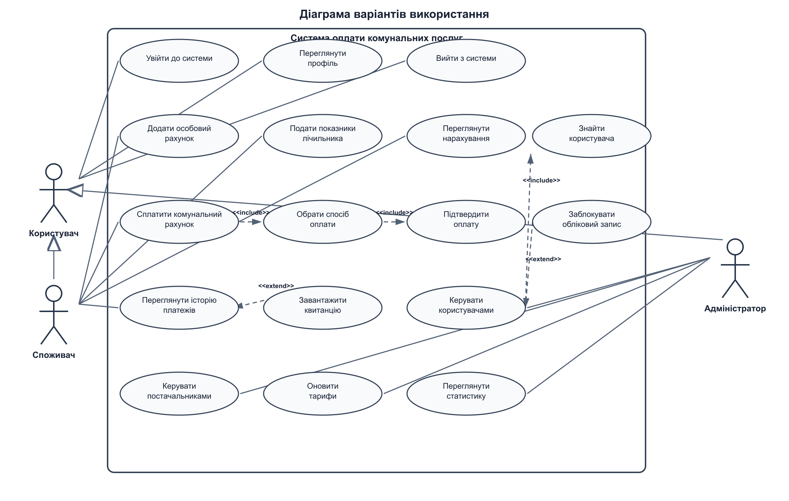
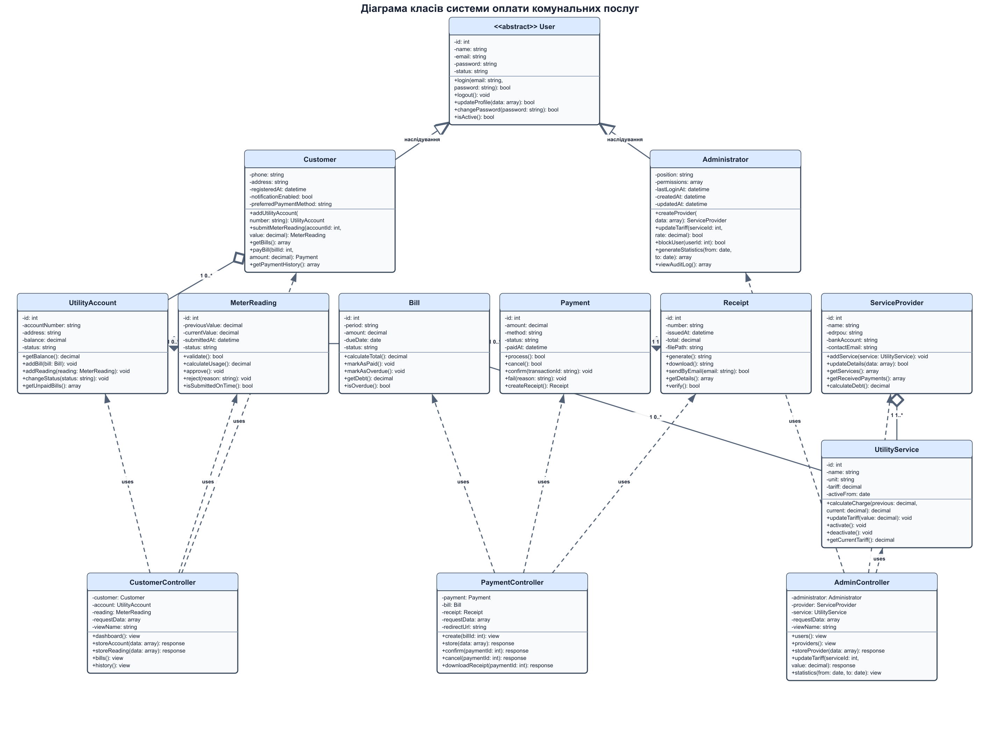

# Архітектура системи оплати комунальних послуг

## Опис предметної галузі

Система призначена для обліку комунальних рахунків, передавання показників лічильників та оплати послуг через веб-інтерфейс. Споживач може прив'язати особові рахунки, переглядати нарахування і заборгованість, виконувати оплату та отримувати квитанції. Адміністратор керує користувачами, постачальниками послуг і тарифами.

## Основні функції

- реєстрація та авторизація користувачів;
- додавання особових рахунків комунальних послуг;
- передавання поточних показників лічильників;
- перегляд нарахувань та заборгованості;
- оплата комунальних рахунків;
- перегляд історії платежів та завантаження квитанцій;
- керування постачальниками, послугами та тарифами.

## Користувачі системи

- Споживач - переглядає рахунки, подає показники та здійснює оплату.
- Адміністратор - керує даними системи та переглядає зведену статистику.

## Архітектура

Веб-додаток будується за архітектурним шаблоном MVC. Моделі відповідають за дані та бізнес-правила, представлення формують веб-інтерфейс, а контролери обробляють HTTP-запити та пов'язують моделі з представленнями.

## Основні сценарії

1. Споживач додає особовий рахунок та переглядає нарахування.
2. Споживач подає поточний показник лічильника, після чого система розраховує споживання.
3. Споживач обирає несплачений рахунок, здійснює оплату та завантажує квитанцію.
4. Адміністратор додає постачальника, створює послугу та вказує тариф.

## Логічні сутності та таблиці бази даних

| Сутність | Призначення | Таблиця БД |
|---|---|---|
| User | Облікові дані користувачів | `users` |
| UtilityAccount | Особові рахунки споживачів | `utility_accounts` |
| ServiceProvider | Постачальники комунальних послуг | `service_providers` |
| UtilityService | Види послуг і тарифи | `utility_services` |
| Bill | Місячні нарахування | `bills` |
| Payment | Оплати рахунків | `payments` |
| MeterReading | Показники лічильників | `meter_readings` |
| Receipt | Квитанції про оплату | `receipts` |

## Вихідні дані

- таблиця поточних нарахувань і заборгованості;
- квитанція про виконану оплату;
- звіт про платежі за обраний період;
- графік динаміки споживання за показниками лічильників.

## Use Case Сплатити комунальний рахунок

**Scope:** система оплати комунальних послуг.

**Level:** User-goal.

**Primary Actor:** споживач.

**Stakeholders and interests:**

- споживач зацікавлений у швидкій та безпечній оплаті рахунку;
- постачальник зацікавлений у точному зарахуванні коштів;
- адміністратор зацікавлений у збереженні коректної історії операцій.

**Preconditions:** споживач авторизований, особовий рахунок додано до профілю, існує несплачене нарахування.

**Main Success Scenario:**

1. Споживач відкриває розділ нарахувань.
2. Система відображає перелік особових рахунків і суму боргу.
3. Споживач обирає потрібний особовий рахунок.
4. Система показує перелік несплачених нарахувань.
5. Споживач обирає рахунок для оплати.
6. Система підставляє суму до сплати.
7. Споживач перевіряє суму та обирає спосіб оплати.
8. Система передає платіжні дані на обробку.
9. Споживач підтверджує оплату.
10. Платіжна система повертає підтвердження успішної операції.
11. Система зберігає платіж і позначає рахунок як сплачений.
12. Система формує квитанцію та відображає її споживачеві.

**Extensions:**

- 2a. Немає доданих особових рахунків. Система пропонує додати рахунок.
- 4a. Всі нарахування сплачено. Система виводить повідомлення про відсутність боргу.
- 6a. Споживач вводить часткову суму. Система перевіряє, що вона більша нуля і не перевищує суму боргу.
- 7a. Обраний спосіб оплати тимчасово недоступний. Система пропонує обрати інший спосіб.
- 9a. Споживач скасовує підтвердження. Система завершує сценарій без змін.
- 10a. Банк відхилив оплату. Система позначає платіж як неуспішний і зберігає рахунок несплаченим.
- 10b. Відсутній зв'язок із платіжною системою. Система не змінює статус рахунку та пропонує повторити операцію.
- 11a. Платіж пройшов, але при збереженні виникла помилка. Система фіксує операцію в журналі та повідомляє адміністратора.

**Postconditions:** успішний платіж збережено, залишок за рахунком оновлено, квитанцію сформовано.

**Special Requirements:** з'єднання має бути захищене HTTPS, подвійне списання одного платежу не допускається.

**Technology and Data Variations List:** оплата може виконуватися банківською карткою або через платіжний сервіс.

**Frequency of Occurrence:** кілька разів на місяць для кожного споживача.

## Діаграма варіантів використання

## Діаграма класів

